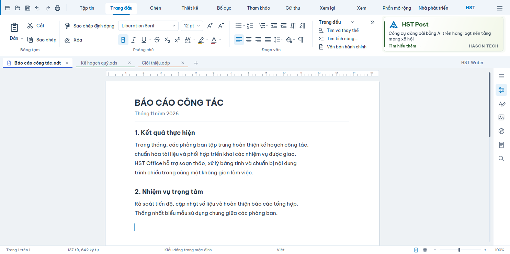

# Đề xuất diện mạo ribbon HST Office

**Đề nghị chọn A — Thoáng và rõ** làm hướng mặc định. A cải thiện độ rõ của icon, khoảng cách và phân cấp thị giác, đồng thời giữ cách đọc nhóm lệnh quen thuộc. **B — Gọn theo cụm** là phương án khác để đối chiếu: nhãn nhóm ở trên, nút nhỏ hơn, nền cụm rõ hơn và một lối vào “Kiểu” trực tiếp. B phù hợp khi ưu tiên mật độ lệnh, nhưng dễ chật hơn khi font hoặc kích thước điều khiển native thay đổi.

Đây là **đề xuất thiết kế**, chưa triển khai vào sản phẩm. Bốn PNG đều **1485 × 740 px**, hiển thị ở 100%; chiều cao phần tài liệu được chọn để tập trung vào ribbon. Chỉ tạo tài liệu trong thư mục này; không sửa mã sản phẩm, không commit, không push.

| Phương án | Giao diện sáng | Giao diện tối |
|---|---|---|
| **A — Khuyến nghị** | [a-light.png](a-light.png) | [a-dark.png](a-dark.png) |
| B — Gọn theo cụm | [b-light.png](b-light.png) | [b-dark.png](b-dark.png) |

**Cơ sở tham chiếu và cách vẽ**

Đã đọc [ảnh bố trí banner](../banner-on-writer.png), các ảnh [Writer](../../../extensions/hst-vietnamese-tools/help/images/writer-home.png), [Sheets](../../../extensions/hst-vietnamese-tools/help/images/calc-home.png), [Slides](../../../extensions/hst-vietnamese-tools/help/images/impress-home.png), rồi đối chiếu với `.ui`, bản dịch và bản HST đang cài. Ảnh hướng dẫn cũ ghi “Phông”, “Bố trí”, “Tham chiếu”, “Công cụ”; các override hiện hành ghi **“Phông chữ”, “Bố cục”, “Tham khảo”, “Nhà phát triển”**. Mockup theo [bản dịch hiện hành](../../../l10n/vi-overrides.jsonl) và thứ tự tab trong [patch ribbon](../../../patches/libreoffice/hst-ribbon-tabs.patch).

Toàn bộ giao diện, đường nét icon lệnh, thước và trang minh họa được vẽ mới bằng SVG trong render.py, xuất PNG bằng CairoSVG. Không ghép screenshot làm nền, không nhập icon Microsoft hoặc sao chép Colibre. Các hình kéo, clipboard, chữ B/I/U và căn lề được tự dựng trên lưới 24 đơn vị; đây là ký hiệu chức năng phổ biến. Bộ nét nhất quán, font, nền và trạng thái chọn tạo nhận diện HST riêng. Không sử dụng font Microsoft; UI dùng **Be Vietnam Pro**, font OFL đã có trong repo. Ô chọn font ghi **Liberation Serif**. Riêng banner HST Post dùng [ảnh quảng cáo HST có sẵn](../../../extensions/hst-vietnamese-tools/banners/hst-post@3x.png), giữ nguyên nội dung và thương hiệu.

Mục tiêu học từ ribbon hiện đại là phân cấp rõ, nút có trạng thái dễ nhận ra, ít nhiễu màu và nhãn dễ đọc. Không tái tạo nguyên mẫu giao diện, logo, palette hay hệ icon Microsoft.

**Các mốc kích thước bắt buộc**

Đã đo qua AT-SPI trên bản cài `/opt/hst`, GTK3/Xvfb, cửa sổ 1485 × 900, scale 1, profile tạm. Dùng các hàm có sẵn trong [check-ribbon-tabs.py](../../../tests/runtime/check-ribbon-tabs.py). Cả Writer và Sheets trả về cùng số đo dưới đây; lưu tại [runtime-measurements.json](runtime-measurements.json). Đây là phép đo bản cài hiện có, không phải phép đo sản phẩm sau khi triển khai thiết kế.

| Vùng | Tọa độ / kích thước ở 100% |
|---|---|
| Đỉnh cửa sổ tham chiếu | y = 0 |
| Hàng truy cập nhanh và tab | y = 0…43; cùng một hàng như ảnh hiện tại |
| Tab page chứa nhóm lệnh, suy ra từ công thức banner | x = 9, y = 44, rộng 1467, cao 111 |
| **Khung banner cố định trong cả bốn mockup** | **x = 1112, y = 46, rộng 360, cao 107** |
| Mép phải khung banner | x = 1472; còn 13 px tới mép cửa sổ |
| Khoảng cách nhóm lệnh — banner | 8 px; phần lệnh kết thúc ở x = 1104 |
| Vùng còn lại cho nhóm lệnh | rộng 1095 px, từ x = 9 |
| **Đầu thanh thẻ tài liệu** | **y = 164**, Writer và Sheets |

Tọa độ dùng quy ước cạnh phải/dưới không thuộc hình chữ nhật. Không thêm hàng title bar vào mockup. Mốc 0 theo cửa sổ nội dung mà ảnh tham chiếu và AT-SPI đo được; trang trí cửa sổ của hệ điều hành cần kiểm tra riêng khi port.

**360 × 107 là khung, 360 × 104 là tỷ lệ ảnh quảng cáo.** Trong [HstBannerGeometry.hxx, được thêm bởi patch](../../../patches/libreoffice/hst-ribbon-banner.patch), `slotFor()` lấy chiều cao page trừ hai lề 2 px, chặn chiều rộng ở 360, lề phải 4 px; `pageWidthBeside()` chừa thêm 8 px. Với page ở trên: `h = 111 − 4 = 107`, `w = min(360, 107 × 360 / 104) = 360`, `x = 9 + 1467 − 4 − 360 = 1112`, `y = 44 + 2 = 46`. Widget inset ảnh 3 px rồi aspect-fit: ảnh minh họa chiếm 349 × 101 tại (1117, 49). Mockup giữ chính xác khung và phép fit này, kể cả dark mode.

164 px là **số đo runtime và yêu cầu nghiệm thu**, không phải một hằng số chiều cao tìm thấy trong `.ui`. Ribbon hiện lấy requisition từ các widget. Không thể chứng minh chỉ bằng XML rằng một thay đổi font hoặc icon sẽ luôn giữ nguyên 164 px.

**A và B khác nhau như thế nào**

| Thành phần | A — Thoáng và rõ | B — Gọn theo cụm |
|---|---|---|
| Nền nhóm | Một mặt phẳng; đường phân nhóm ngắn, nhẹ | Các cụm có viền mềm; thanh nút có nền riêng |
| Nhãn nhóm | Ở chân nhóm, chữ đứng 11,5 px | Ở đầu nhóm, 11,5 px đậm vừa |
| Icon lệnh thường trong bản vẽ | Khung 20–21 px; nút thường cao 30–32 px | Khung 16–18 px; nút thường cao 27–29 px |
| Dán | Icon 32 px, nhãn dưới | Icon 20 px, nhãn ngang, menu bên phải |
| Tab đang chọn | Nền nổi nhẹ và nét xanh HST ở chân | Thẻ xanh HST đặc, chữ trắng |
| Kiểu | Giữ gallery trong vùng mở rộng `»` | Nút “Kiểu” mở gallery trong popup |
| Khối bên phải | Trang đầu; Tìm và thay thế; Tìm tính năng…; Văn bản hành chính | Cùng các lệnh đó, thêm lối vào Kiểu |
| Đổi bố cục | Giữ nhãn nhóm dưới, giữ Dán dạng đứng | Đổi vị trí nhãn, Dán dạng ngang, thêm wrapper cho gallery |

Ở A, nhóm Bảng tạm kết thúc trước x = 174; Phông chữ nằm giữa các đường phân nhóm x = 174 và 669; Đoạn văn nằm giữa x = 669 và 910; khối phải dùng x = 927…1104. Ở B, các khung nhóm lần lượt là (10, 50, 154, 106), (172, 50, 476, 106), (656, 50, 220, 106); khối phải bắt đầu x = 884. Các kích thước này là **đề xuất mới**, không phải số đo layout hiện hành.

Cả hai hiển thị đầy đủ “Dán”, “Cắt”, “Sao chép”, “Sao chép định dạng”, “Xóa”, “Bảng tạm”, “Phông chữ”, “Đoạn văn”, “Trang đầu” và các lệnh HST ở khối phải. Không rút gọn các nhãn dài để giành chỗ cho icon. Các lệnh định dạng icon-only giữ tooltip và tên truy cập theo UNO. Bản vẽ thể hiện 33 glyph lệnh Trang đầu, 6 glyph truy cập nhanh, cộng 3 glyph điều hướng (`menu`, `»`, mũi tên xuống): **42 glyph ribbon khác nhau**, tự vẽ, đủ để đánh giá một hệ icon. Chưa phải bộ icon đóng gói sản phẩm.

Không tăng đồng loạt icon lên 32 px. Với vùng lệnh 1095 px và tên tiếng Việt dài, làm vậy sẽ đẩy cả nhóm vào overflow. A dành 32 px cho Dán, giữ nút định dạng ở cỡ trung bình. Khi thiếu chiều ngang, thu gallery Kiểu trước; giữ Bảng tạm, font và căn đoạn ưu tiên cao. Giữ cơ chế overflow; không ép co chữ hoặc cắt nhãn. B vẫn là ribbon hai hàng lệnh trong khung hiện tại, không chuyển sang `notebookbar_compact.ui`.

**Màu sắc và trạng thái**

[brand-spec.json](../../../assets/brand/brand-spec.json) xác định HST `#0072BB`, Writer `#2F5BD3`, Sheets `#1E8E3E`, Slides `#E8590C`. [CSS website](../../../website/office.hasontech.vn/assets/css/style.css) có màu chữ `#172D47`, chữ phụ `#536379`, đường viền `#DCE6F0` và font Be Vietnam Pro. Chọn xanh từ brand-spec làm màu hành động thống nhất; màu module chỉ đánh dấu thẻ tài liệu. Không dùng toàn bộ dải nhiều màu cho các lệnh thông thường.

| Token | Sáng | Tối |
|---|---|---|
| Mặt ribbon | `#FFFFFF` | `#1C2B3B` |
| Dải tab | `#F0F5FA` | `#162435` |
| Chữ chính | `#172D47` | `#E8F0F7` |
| Chữ phụ | `#536379` | `#AFBDCE` |
| Nét icon | `#294159` | `#DBE7F1` |
| Trạng thái chọn | nền `#E5F2FB`, nét `#0072BB` | nền `#234762`, nét `#78C5F4` |
| Đường phân nhóm | `#DCE6F0` | `#35485C` |

Các màu dark và màu nền mới là **token đề xuất**, không nhận là màu thương hiệu đã được phê duyệt. `#78C5F4` là màu chức năng sáng hơn để đọc được trên nền tối; logo và banner giữ màu gốc. Chỉ màu chữ/tô sáng tài liệu cần vạch màu nhỏ để báo lựa chọn hiện tại.

Mockup thể hiện trạng thái thường và đang chọn. Khi triển khai cần bổ sung hover, pressed, disabled và focus: focus bằng viền 2 px rõ, không chỉ đổi sắc độ; pressed đậm hơn selected; disabled giảm sắc độ nhưng tooltip vẫn đọc được. Tương phản chữ chính trên panel đo được 13,97:1 sáng và 12,51:1 tối; nhãn nhóm 6,12:1 và 7,54:1. Đây không phải chứng nhận toàn bộ UI đạt accessibility: viền ô nhập nhẹ trong mockup còn cần tăng tương phản ở trạng thái focus/high contrast. Trang tài liệu tối chỉ minh họa môi trường nhìn, không đề xuất đổi màu nội dung khi in.

**Phạm vi icon đã kiểm đếm**

Đã lấy đúng source commit `bf6ef2662401c7d6dce671ab4deb26ee0af3a7c1` trong [libreoffice-lock.json](../../../upstream/libreoffice-lock.json), đọc nguồn LibreOffice 26.8.1.1, rồi tái tạo ba `notebookbar.ui` bằng các patch trong `series` **trên bản sao tạm**. Không sửa checkout HST hoặc source dùng để build. audit.py có thể chạy lại; [icon-counts.json](icon-counts.json) ghi SHA-256, patch đã áp và số đếm; [icon-inventory.csv](icon-inventory.csv) liệt kê từng widget, command, visibility, key và file icon tra được.

Đếm URL lệnh duy nhất, không đếm một lệnh lặp trên nhiều tab nhiều lần. Tách `GtkToolButton`/`GtkMenuToolButton` khỏi các mục menu. Loại ô tên font, cỡ chữ, gallery StylesPreview, ô định dạng số, ô số đo lề/khoảng cách, ô số trang và bộ media tổng hợp khỏi tập glyph đơn; danh sách loại trừ đầy đủ nằm trong script. `visible=True` là khai báo XML, chưa xét lựa chọn văn bản, CTL/CJK, context và việc nhóm bị thu vào popup.

| Phạm vi | Writer | Sheets | Slides | Hợp nhất ba ứng dụng |
|---|---:|---:|---:|---:|
| URL lệnh trong Home, trước loại controller | 40 | 55 | 44 | — |
| Glyph Home, gồm nút XML đang ẩn | 37 | 52 | 42 | 77 |
| Glyph Home có `visible=True` | 33 | 49 | 41 | 76 |
| Home + truy cập nhanh, theo URL lệnh | **43** | **58** | **47** | **85** |
| Họ tài nguyên Home + truy cập nhanh tìm được, sau alias | 43 | 57 | 47 | **77** |
| Lệnh Home chưa tra được key trong bộ đối chiếu | 0 | 1 | 0 | **1** |

**Đề xuất ngân sách vẽ Home + truy cập nhanh: 78 mẫu gốc dùng chung** = 77 họ tài nguyên đã đếm + 1 mẫu cho `.uno:ClearContents` của Sheets, với giả định giữ quan hệ dùng chung/alias hiện tại. Nếu quyết định mỗi URL một hình riêng thì cần 85 mẫu. Số 78 là kế hoạch suy ra từ kiểm kê, không phải 78 icon đã hoàn thiện trong đề xuất này. Không cộng 43 + 58 + 47 để tính khối lượng vì các ứng dụng dùng chung nhiều lệnh; riêng Home có 20 URL lệnh chung cho cả ba.

Để hiện đại hóa **toàn bộ các tab ribbon**, số lớn hơn đáng kể:

| Phạm vi từ source HST tái tạo | Writer | Sheets | Slides | Hợp nhất |
|---|---:|---:|---:|---:|
| URL nút toolbar trong toàn bộ notebookbar | 299 | 278 | 265 | — |
| Sau loại controller, cộng truy cập nhanh: điểm cần kiểm tra icon | **293** | **277** | **264** | **498** |
| Họ tài nguyên tra được sau alias | **277** | **247** | **252** | **419** |
| URL chưa tra được tài nguyên theo quy tắc kiểm kê | 1 | 18 | 4 | **22** |
| Hồ sơ thiết kế dự trù nếu mỗi URL chưa tra được cần một mẫu mới | **278** | **265** | **256** | **441** |

Tra `cmd/sc_<command>.png` hoặc `icon-name` khai báo riêng, theo chuỗi `links.txt` trong [icon-themes/colibre](https://github.com/LibreOffice/core/tree/bf6ef2662401c7d6dce671ab4deb26ee0af3a7c1/icon-themes/colibre), rồi chuẩn hóa tiền tố `sc_`, `lc_`, `32_` thành một họ hình. Chỉ dùng bộ này để kiểm kê cách ánh xạ, không dùng hình của nó cho mockup. Cũng đã đọc cấu trúc [Sifr](https://github.com/LibreOffice/core/tree/bf6ef2662401c7d6dce671ab4deb26ee0af3a7c1/icon-themes/sifr) và Sifr dark để xác định cách tổ chức bộ sáng/tối.

**441 là dự trù có điều kiện, 498 là số điểm ánh xạ đã đếm, không phải khẳng định có đúng 441 icon tĩnh đang hiển thị.** “Chưa tra được” không có nghĩa sản phẩm thiếu icon: controller có thể tạo hình, dùng ImageManager, metadata hoặc fallback khác. Cần rà riêng 22 URL trong JSON trước khi giao vẽ; các controller như tô màu, nét vẽ và mẫu đường cần kiểm tra trạng thái động. Giữ alias thì giảm mẫu gốc; tách hình theo ngữ nghĩa từng ứng dụng thì tăng. Chưa gồm menu riêng không xuất hiện dưới dạng nút toolbar, popup tự sinh, media transport, sidebar, hộp thoại hoặc extension ngoài HST. Vì vậy không gọi đây là số icon của toàn bộ bộ ứng dụng.

Light/dark dùng chung hình học; xuất màu riêng. Nếu xuất đủ 16/24/32 cho hai theme thì 78 mẫu Home tương ứng tối đa 468 biến thể, 441 hồ sơ toàn ribbon tương ứng tối đa 2646 biến thể. Đây là **phép tính dự trù xuất file**, không phải số hình phải vẽ tay; SVG và alias nên được sinh tự động, chỉ chỉnh quang học ở cỡ nhỏ.

**Khác biệt giữa checkout và bản cài**

Bản cài `/opt/hst` không trùng byte với `.ui` tái tạo từ repo. Nó có thêm 13 URL toolbar ở Writer/Slides, 14 ở Sheets, chủ yếu tab biểu đồ ngữ cảnh và `RemoveCalcTable`; còn có khác biệt lớp priority. JSON ghi rõ từng URL và hash. Tập URL Home của ba ứng dụng **trùng nhau**. Vì vậy dùng bản cài để đo vị trí/chiều cao hiện tại, dùng source khóa + patch repo để tính khối lượng triển khai. Không lấy số icon từ bản cài rồi gọi đó là số của checkout. Cần thống nhất baseline này trước khi triển khai các tab ngữ cảnh; không ảnh hưởng bốn bản vẽ Home.

**Phần nào là theme/icon, phần nào cần code**

| Hạng mục | Đổi tài nguyên / `.ui` | Code cần thiết để đạt đúng bản vẽ |
|---|---|---|
| Bộ nét một màu, màu chữ/tô sáng, sáng/tối | Bộ `hst`/`hst_dark`, SVG/PNG, `links.txt`; cấu hình chọn theme; thêm vào khâu đóng gói | Thường không cần đổi dispatch. Cần kiểm tra đổi theme và fallback, tránh lọt icon cũ |
| Nhãn nhóm đứng, margin, spacing, vị trí Dán và khối phải | Sửa ba `.ui`; A giữ nhãn dưới, B đưa lên trên | Chưa đủ để đảm bảo min-size native không đẩy cao ribbon |
| Dán lớn | `icon_size=5` cho 32 px, thay resource | Đã có đường hỗ trợ 32 px |
| Icon A 20 px / B 18 px như ảnh | Có thể vẽ trong canvas 24 px; chỉnh padding bộ icon | Kích thước canvas khác kích thước nét. Muốn đúng hitbox và mật độ mockup cần metric riêng cho notebookbar; không chỉ đổi ảnh |
| Tab chọn, màu panel, viền/bo góc, focus | Có thể cấu hình một phần màu | Vẽ VCL có phạm vi riêng cho notebookbar; native theme không bảo đảm cùng hình dạng |
| Các dải nút B, tiêu đề trên, nút Kiểu | Repack grid và wrapper popup trong `.ui` | B cần thêm xử lý nền cụm/gallery popup, focus và anchor khi reparent |
| Combo font/cỡ chữ | Width request và label trong `.ui` | Border, arrow, native min-height và focus cần kiểm tra/chỉnh ở controller/VCL |
| Banner | Giữ resource và cấu hình hiện có | Giữ nguyên thuật toán slot, timer, focus, accessible link và sự kiện layout trễ |

Đường triển khai nên tách rõ:

1. **Giai đoạn tài nguyên:** thay icon, chỉnh nhãn/margin `.ui`, giữ metric native. Có thể tiến gần A nhưng chưa hứa giống hệt PNG hoặc giữ 164 px khi tăng canvas icon.
2. **Giai đoạn đạt thiết kế:** bổ sung token màu và metric riêng cho notebookbar, vẽ trạng thái tab/nút có giới hạn, đo lại layout khi đổi theme/context. Không thay toàn bộ điều khiển VCL dùng chung.
3. **Mở rộng sang Sheets/Slides:** giữ token và glyph chung, phân bổ chiều ngang theo từng `.ui`. Writer và Sheets phải giữ y = 164 ở 100%; không dùng việc bỏ banner để che lỗi tràn.

**Những nơi trong nguồn đã đọc và hệ quả cụ thể**

| Nguồn | Điều đã xác nhận / hệ quả triển khai |
|---|---|
| [vcl/source/control/tabctrl.cxx](https://github.com/LibreOffice/core/blob/bf6ef2662401c7d6dce671ab4deb26ee0af3a7c1/vcl/source/control/tabctrl.cxx#L1088) | `Paint()` gọi native TabPane/TabHeader/TabItem; `NotebookbarTabControlBase::ImplPlaceTabs()` đặt shortcut, menu và một hàng tab, có ngưỡng rộng 100 và cao 28. Chỉ đổi PNG không đổi hình tab. Phải xét cả phần tính kích thước lẫn Paint |
| [vcl/source/control/notebookbar.cxx](https://github.com/LibreOffice/core/blob/bf6ef2662401c7d6dce671ab4deb26ee0af3a7c1/vcl/source/control/notebookbar.cxx#L296) | `UpdateBackground()` blend màu module với DialogColor theo NotebookbarColorTransparency; màu Writer gốc là `#1A85D1`, khác màu HST. Đổi transparency không tạo đủ palette đề xuất |
| [vcl/source/control/button.cxx](https://github.com/LibreOffice/core/blob/bf6ef2662401c7d6dce671ab4deb26ee0af3a7c1/vcl/source/control/button.cxx#L1053), [fixed.cxx](https://github.com/LibreOffice/core/blob/bf6ef2662401c7d6dce671ab4deb26ee0af3a7c1/vcl/source/control/fixed.cxx#L620), [combobox.cxx](https://github.com/LibreOffice/core/blob/bf6ef2662401c7d6dce671ab4deb26ee0af3a7c1/vcl/source/control/combobox.cxx#L1008) | Button native drawing, FixedLine và ComboBox min-size/focus là các điểm cần xem; không sửa màu hoặc radius toàn cục vì sẽ ảnh hưởng hộp thoại |
| [vcl/source/window/toolbox.cxx](https://github.com/LibreOffice/core/blob/bf6ef2662401c7d6dce671ab4deb26ee0af3a7c1/vcl/source/window/toolbox.cxx#L1360) | Các nút ribbon là ToolBox, không chỉ PushButton. `GetNativeControlRegion()` lấy min-size của toolbar/combobox/listbox/spinbox; icon, nhãn, dropdown và native metric đều ảnh hưởng chiều cao |
| [toolbox2.cxx](https://github.com/LibreOffice/core/blob/bf6ef2662401c7d6dce671ab4deb26ee0af3a7c1/vcl/source/window/toolbox2.cxx#L642), [IconThemeInfo.cxx](https://github.com/LibreOffice/core/blob/bf6ef2662401c7d6dce671ab4deb26ee0af3a7c1/vcl/source/app/IconThemeInfo.cxx#L61) | Small = 16; Large thông thường = 24, tên enum vẫn là Size26; Size32 = 32. Không có sẵn mức 18/20 tương ứng mockup. DPI nhân kích thước ảnh |
| [sfx2/source/sidebar/SidebarToolBox.cxx](https://github.com/LibreOffice/core/blob/bf6ef2662401c7d6dce671ab4deb26ee0af3a7c1/sfx2/source/sidebar/SidebarToolBox.cxx#L302) | `sfxlo-NotebookbarToolBox` được tạo ở đây. `icon_size` 1/2/4 → Small, 3 → Large, 5 → 32; `both` đặt nhãn dưới, `both-horiz` đặt ngang. Giá trị mặc định lấy NotebookbarIconSize |
| [vcl/source/control/PriorityMergedHBox.cxx](https://github.com/LibreOffice/core/blob/bf6ef2662401c7d6dce671ab4deb26ee0af3a7c1/vcl/source/control/PriorityMergedHBox.cxx#L32), [DropdownBox.cxx](https://github.com/LibreOffice/core/blob/bf6ef2662401c7d6dce671ab4deb26ee0af3a7c1/vcl/source/control/DropdownBox.cxx#L32) | Có cơ chế ẩn nhóm/mở popup, nút chevron width request 25 nhưng dự phòng BUTTON_WIDTH 30; popup chuyển parent của widget. Phải giữ keyboard/focus/context khi thu nhóm; tính cả bề rộng nút mở rộng |
| [vcl/uiconfig/ui/combobox.ui](https://github.com/LibreOffice/core/blob/bf6ef2662401c7d6dce671ab4deb26ee0af3a7c1/vcl/uiconfig/ui/combobox.ui) và [vcl/uiconfig](https://github.com/LibreOffice/core/tree/bf6ef2662401c7d6dce671ab4deb26ee0af3a7c1/vcl/uiconfig) | Có entry, toggle button, arrow và accessible role; đây không phải một stylesheet ribbon trung tâm. Sửa tại đây có phạm vi rộng hơn notebookbar |
| [Writer .ui](https://github.com/LibreOffice/core/blob/bf6ef2662401c7d6dce671ab4deb26ee0af3a7c1/sw/uiconfig/swriter/ui/notebookbar.ui), [Sheets .ui](https://github.com/LibreOffice/core/blob/bf6ef2662401c7d6dce671ab4deb26ee0af3a7c1/sc/uiconfig/scalc/ui/notebookbar.ui), [Slides .ui](https://github.com/LibreOffice/core/blob/bf6ef2662401c7d6dce671ab4deb26ee0af3a7c1/sd/uiconfig/simpress/ui/notebookbar.ui) + patch HST | Grid Home hiện dùng margin dọc 6 và spacing 3 ở nhiều nhóm, nhãn italic scale 0.9. `.ui` chứa action, grid, priority; phải sửa bản đã áp patch. Chữ `Gtk` trong tên widget không có nghĩa desktop ribbon là trang HTML/CSS: nó đi qua VclBuilder |
| [hst-ribbon-panel.patch](../../../patches/libreoffice/hst-ribbon-panel.patch) | HST đã tách cách tô panel: GTK/Qt dùng native, Windows/macOS/generic thêm fill DialogColor/WindowColor. Đây là điểm xuất phát để thêm token theo notebookbar, tránh tái xuất hiện nền xanh phủ kín |

**Ước lượng công việc — chưa phải số đo năng suất**

Đơn vị dưới đây là **ngày công**, giả định có một người thiết kế icon và một kỹ sư quen VCL; có sẵn máy build ba nền tảng. Không cộng thời gian chờ môi trường hoặc review upstream. Mức vẽ icon gồm lưới nhỏ, trạng thái sáng/tối và rà tính nhất quán; hình học dùng chung nên dark mode không nhân đôi công vẽ.

| Phần việc | A | B |
|---|---:|---:|
| Chốt hệ icon Home dùng chung, dự trù 78 mẫu | 8–12 ngày thiết kế | 8–12 ngày thiết kế |
| Đóng gói theme + chỉnh `.ui` ba ứng dụng | 3–5 ngày kỹ thuật | 4–7 ngày kỹ thuật |
| VCL metric/paint riêng, đạt sát PNG và giữ ngân sách chiều cao | 6–10 ngày kỹ thuật | 8–14 ngày kỹ thuật |
| Kiểm tra ba nền tảng, DPI, focus và overflow | 5–8 ngày kiểm tra/sửa lỗi | 6–9 ngày kiểm tra/sửa lỗi |

Đây là **ước lượng**, không suy ra từ số dòng code. B tăng công vì nền cụm, nhãn ở trên và popup Kiểu. Nếu chỉ thay bộ icon và spacing, công kỹ thuật ít hơn nhưng hình dạng native vẫn khác ảnh. Mở rộng từ Home lên toàn ribbon: dự trù thêm **30–50 ngày công thiết kế** cho phần còn lại của backlog 441 hồ sơ, sau khi rà 22 URL chưa xác định và controller động; cần ước lượng lại phần kỹ thuật sau pilot. Không tính các menu/hộp thoại ngoài phạm vi kiểm kê.

**Rủi ro và điều kiện nghiệm thu sản phẩm**

| Nền tảng / tình huống | Rủi ro có căn cứ | Cách xử lý dự kiến |
|---|---|---|
| GTK3 | Native theme quyết định kích thước combo, tab, toolbar; HST panel patch bỏ qua nhánh tự tô trên GTK | Thử Adwaita sáng/tối và font hệ thống khác; không coi GTK CSS là cách sửa mọi VCL backend; đo lại sau khi allocation và sự kiện banner trễ hoàn tất |
| Windows | [salnativewidgets-luna.cxx](https://github.com/LibreOffice/core/blob/bf6ef2662401c7d6dce671ab4deb26ee0af3a7c1/vcl/win/gdi/salnativewidgets-luna.cxx) dùng theme native và nhánh dark; min-size/font/DPI có thể khác Linux | Kiểm tra 100/125/150/200%, đổi màn hình DPI khác nhau, dark/high contrast; không ép clip glyph để đạt 164 |
| macOS | [salnativewidgets.cxx](https://github.com/LibreOffice/core/blob/bf6ef2662401c7d6dce671ab4deb26ee0af3a7c1/vcl/osx/salnativewidgets.cxx) có TabPane/native drawing; Retina, focus và vị trí menu/title bar khác | Giữ tọa độ logic, thử Retina 2×; kiểm tra focus khi popup đóng, light/dark; đo mốc cửa sổ nội dung thống nhất, không cộng menu toàn hệ thống vào ribbon |
| Sheets | Home có nhiều nhóm hơn Writer: Căn chỉnh, Số, Kiểu, Ô, Chỉnh sửa | Không bê nguyên các bề rộng nhóm của Writer. Cùng chiều cao 164, cùng slot banner, ưu tiên font/căn chỉnh/số; đo các nhóm bị thu vào overflow |
| Việt hóa và font | Be Vietnam Pro có metric khác font OS; dấu trên/dưới và “Sao chép định dạng” dễ cắt | Giữ nhãn nguyên văn, kiểm tra fallback font; cân nhắc đóng gói Be Vietnam Pro cho UI hoặc chấp nhận native font với chiều rộng thích nghi |
| Dark/high contrast | SVG có màu cứng hoặc alias fallback làm mất nét; banner sáng nổi bật hơn trong nền tối | Bộ dark riêng, focus rõ; giữ banner sáng đúng cơ chế hiện tại; không tự đảo màu ảnh quảng cáo |
| Nút và context | Bold/Italic, màu chữ, điều kiện CTL/CJK, selection và gallery có trạng thái động | Giữ UNO action và controller; không thay widget tương tác bằng ảnh phẳng; giữ accessible name, phím tắt, tooltip và focus ring |
| Cửa sổ hẹp | Hiện tại banner ẩn dưới 1280 logical px; thu nhóm và popup có thể bị tràn sau đổi metric | Giữ hành vi ngưỡng hiện có; kiểm tra 1279/1280/1485 và cửa sổ hẹp hơn. Yêu cầu slot cố định của đề xuất áp dụng tại 1485 px |

Khi triển khai, chạy lại [check-ribbon-panel.py](../../../tests/runtime/check-ribbon-panel.py), [check-ribbon-tabs.py](../../../tests/runtime/check-ribbon-tabs.py) và [check-ribbon-banner.py](../../../tests/runtime/check-ribbon-banner.py) với baseline đã thống nhất. Ở 1485 px / 100%, Writer và Sheets phải cùng kết thúc ribbon tại y = 164; slot banner phải đúng (1112, 46, 360, 107), không che lệnh. Kiểm tra cả khi đổi tab, context, theme và resize. Ở scale 2, so theo pixel logic và xác nhận ánh xạ ra pixel thiết bị; không dùng số 164 pixel vật lý trên Retina. Các kiểm tra sau triển khai chưa được chạy vì chưa có thay đổi sản phẩm.

**Bàn giao và xác minh bản vẽ**

Đã mở xem cả bốn PNG, kiểm tra nhãn tiếng Việt và bố cục ở kích thước thật. [validation.json](validation.json) xác nhận cả bốn ảnh rộng 1485, cao 740; pixel ảnh quảng cáo bên trong slot giống nhau hoàn toàn; ghi hash và tương phản token. [drawing-metrics.json](drawing-metrics.json) ghi tọa độ, kích thước và glyph; source/ giữ bốn SVG chỉnh sửa được. Không có thao tác push.

Script dựng mockup và đếm icon của lượt đề xuất không nằm trong repository; `icon-inventory.csv` và `icon-counts.json` là kết quả đã lưu.
